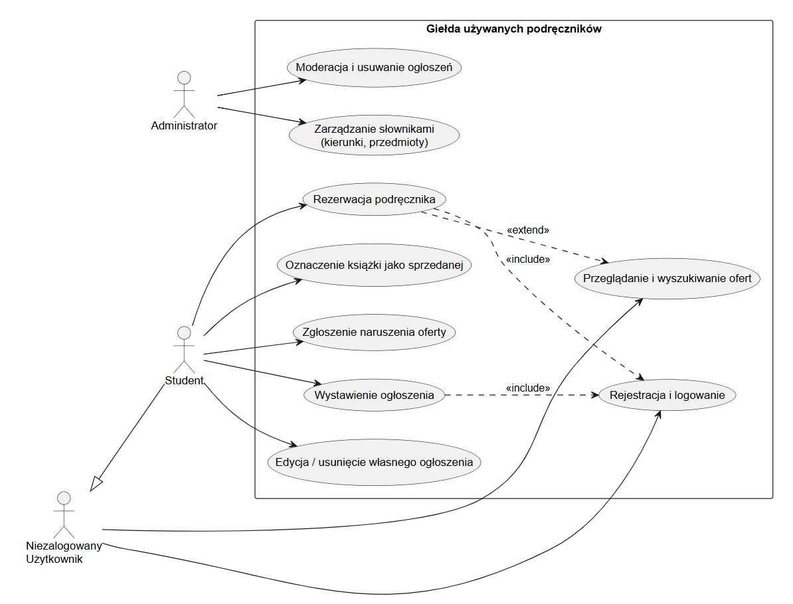

# Przypadki użycia (Use Cases)

## Diagram przypadków użycia

---

## Opis najważniejszych przypadków użycia

### UC1: Wystawienie ogłoszenia o sprzedaży podręcznika

* **Aktor główny:** Student (Sprzedający)
* **Warunki wstępne:** Użytkownik jest zalogowany w systemie.
* **Warunki końcowe (sukces):** Nowe ogłoszenie zostaje zapisane w bazie danych ze statusem `Dostępna` i jest widoczne na liście ofert.

**Scenariusz główny:**
1. Student wybiera opcję „Dodaj ogłoszenie”.
2. System wyświetla formularz dodawania podręcznika.
3. Student uzupełnia wymagane pola: tytuł książki, autor, przedmiot/kierunek, cena, stan książki (np. dobry, używany) oraz opcjonalnie dodaje zdjęcie.
4. Student klika przycisk „Opublikuj”.
5. System waliduje poprawność wprowadzonych danych (m.in. czy cena jest większa lub równa 0 oraz czy wymagane pola nie są puste).
6. System zapisuje ogłoszenie w bazie danych i wyświetla komunikat o pomyślnym opublikowaniu oferty.

**Scenariusze alternatywne / sytuacje wyjątkowe:**
* **5a. Błędne lub niekompletne dane w formularzu:**
  1. System wykrywa brak wymaganego pola lub niepoprawną wartość (np. ujemna cena, za duży rozmiar zdjęcia).
  2. System podświetla błędne pola i wyświetla komunikat z prośbą o poprawę.
  3. Powrót do kroku 3 scenariusza głównego.
* **4a. Użytkownik anuluje dodawanie:**
  1. Student klika „Anuluj” lub opuszcza stronę.
  2. System nie zapisuje danych i przekierowuje na stronę główną.

---

### UC2: Wyszukanie i rezerwacja podręcznika

* **Aktor główny:** Student (Kupujący)
* **Aktorzy pomocniczy:** Student (Sprzedający)
* **Warunki wstępne:** Użytkownik jest zalogowany w systemie. W systemie istnieje co najmniej jedno ogłoszenie ze statusem `Dostępna`.
* **Warunki końcowe (sukces):** Status ogłoszenia zmienia się na `Zarezerwowana`, a sprzedający otrzymuje powiadomienie z danymi kontaktowymi kupującego.

**Scenariusz główny:**
1. Kupujący wpisuje tytuł książki lub wybiera filtry (kierunek studiów, przedmiot, maksymalna cena) w wyszukiwarce.
2. System wyświetla listę pasujących ogłoszeń.
3. Kupujący wybiera interesującą go ofertę, aby zobaczyć szczegóły (opis, zdjęcia, dane kontaktowe/formularz).
4. Kupujący klika przycisk „Zarezerwuj podręcznik”.
5. System sprawdza, czy oferta jest nadal dostępna i czy kupujący nie próbuje zarezerwować własnego ogłoszenia.
6. System zmienia status ogłoszenia na `Zarezerwowana` i wysyła powiadomienie (np. e-mail) do sprzedającego z informacją o rezerwacji oraz kontaktem do kupującego.
7. System wyświetla kupującemu potwierdzenie rezerwacji.

**Scenariusze alternatywne / sytuacje wyjątkowe:**
* **2a. Brak wyników wyszukiwania:**
  1. System nie znajduje żadnych ofert spełniających kryteria.
  2. System wyświetla komunikat „Brak ogłoszeń spełniających podane kryteria” i proponuje wyczyszczenie filtrów.
* **5a. Podręcznik został właśnie zarezerwowany przez kogoś innego:**
  1. W momencie kliknięcia „Zarezerwuj” status oferty w bazie to już `Zarezerwowana` lub `Sprzedana`.
  2. System blokuje akcję i wyświetla komunikat: „Oferta jest już nieaktualna”.
* **5b. Próba rezerwacji własnego ogłoszenia:**
  1. System wykrywa, że ID kupującego jest takie samo jak ID sprzedającego.
  2. System blokuje rezerwację i wyświetla odpowiedni komunikat błędu.